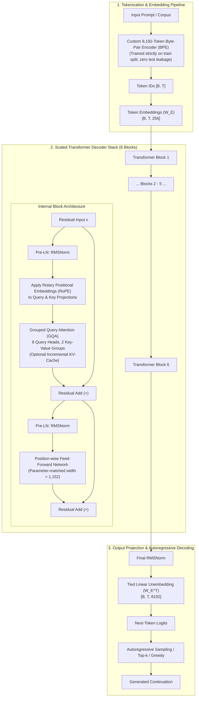
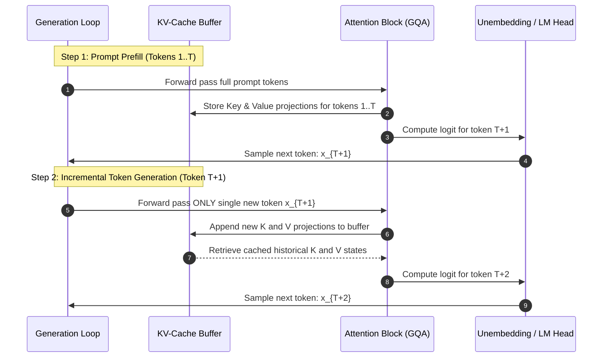

# PicoGPT: A Decoder-Only GPT Built from First Principles

[](https://www.python.org/downloads/)
[](https://pytorch.org/)
[](https://developer.nvidia.com/cuda-zone)
[]()
[](LICENSE)

An end-to-end, from-scratch implementation and empirical study of a decoder-only **Generative Pre-trained Transformer (GPT)**.

The project traces the complete evolutionary arc of transformer engineering: from foundational mathematical building blocks (hand-derived gradients, manual backpropagation, custom BPE tokenization) to a production-grade, scaled **6.62M-parameter language model** incorporating modern architectural paradigms—including **Rotary Positional Embeddings (RoPE)**, **RMSNorm**, **Grouped Query Attention (GQA)**, and an incremental **KV-cache** for accelerated inference.

---

## Architecture & System Overview



---

## Architectural Specifications

The scaled reference model family is configured for reproducible, parameter-matched evaluations:

| Component | Specification | Rationale & Architectural Design |
| :--- | :--- | :--- |
| **Parameters** | **6,622,464** | Parameter-matched across all ablation variants |
| **Layers / Blocks** | **6** | Deep decoder stack with Pre-LN residual connections |
| **Embedding Dim ($d_{\text{model}}$)** | **256** | Hidden representation width |
| **Query Heads ($H_Q$)** | **8** ($d_{\text{head}} = 32$) | High-capacity multi-head query projections |
| **Key/Value Groups ($H_{KV}$)** | **2** ($4:1$ query-to-KV ratio) | **Grouped Query Attention (GQA)** reducing memory footprint |
| **Context Length** | **256 tokens** | Autoregressive context window |
| **Positional Encoding** | **Rotary Position Embeddings (RoPE)** | Relative position-aware rotation applied to $Q$ and $K$ |
| **Normalization** | **RMSNorm (Pre-LN)** | Bias-free root mean square layer normalization |
| **Feed-Forward Width** | **1,152** | Exact parameter matching compensation for GQA |
| **Tokenizer** | **8,192 Byte-Level BPE** | Custom BPE fit solely on training partition to eliminate leakage |
| **Weight Tying** | **Tied Input/Output ($W_U = W_E^T$)** | Substantial parameter savings and regularized token representations |
| **Inference Engine** | **Incremental Key-Value Cache** | Avoids redundant attention recomputations during generation |

---

## KV-Cache Inference & Decoding Mechanics

During standard autoregressive generation, computing attention over all preceding tokens at every step incurs an $\mathcal{O}(T^2)$ computational cost. The integrated **Key-Value Cache** stores past key and value states, reducing per-token generation step complexity to $\mathcal{O}(T)$.



---

## Empirical Benchmarks & Experimental Results

### 1. Completed Long Reference Run
Trained with bfloat16 on a Tesla T4 across **16,100 optimizer updates** using an AdamW cosine schedule:

| Metric | Empirical Result | Evaluation Details |
| :--- | :---: | :--- |
| **Test Cross-Entropy Loss** | **1.87108** | Evaluated on held-out test split |
| **Test Perplexity** | **6.49528** | Exponentiated cross-entropy loss ($\exp(1.871)$) |
| **Validation Loss / Perplexity** | **1.84157 / 6.30644** | Internal validation split |
| **Tokens Evaluated** | **2,048,000 tokens** | 500 batches $\times$ 16 sequences $\times$ 256 tokens |
| **KV-Cache Logit Verification** | **Passed ($1.91 \times 10^{-5}$)** | Maximum absolute difference between cached vs. full forward pass (tolerance: $2 \times 10^{-4}$) |

---

### 2. Controlled Architecture Ablation: MHA vs. GQA
A rigorously controlled, parameter-matched comparison evaluated under identical conditions (seed 1337, 4,100 updates, same 80/10/10 split, identical 6,622,464 parameter budget):

| Architectural Variant | Normalization | Attention Configuration | Best Val Loss | Test Loss | Test Perplexity | Top-1 Token Accuracy |
| :--- | :--- | :--- | :---: | :---: | :---: | :---: |
| **Post-LN + MHA** | Post-LN LayerNorm | Multi-Head Attention (8Q / 8KV) | 2.34068 | **2.34940** | **10.479** | 47.37% |
| **Pre-LN + GQA (Ours)** | Pre-LN RMSNorm | Grouped Query Attention (8Q / 2KV) | 2.22066 | **2.23694** | **9.365** | **49.61%** |

* **Key Takeaway**: Pre-LN RMSNorm paired with Grouped Query Attention achieved a **0.112 lower test cross-entropy loss** and a **1.114 reduction in perplexity**, confirming the superior optimization stability of Pre-LN configurations.
* **Logit Parity**: Both variants passed cache-vs-full logit integrity checks with a maximum deviation of only **$1.24 \times 10^{-5}$**.

---

### 3. KV-Cache Decoding Benchmark
Measured decoding 128 continuous tokens on an NVIDIA Tesla T4 across ten trials:

| Prompt Length (Tokens) | Cache-Off Latency | Cache-On Latency | Peak Memory: Off $\to$ On | Output Token Match |
| :---: | :---: | :---: | :---: | :---: |
| **32** | 0.8314 s | 0.9372 s | **11.30 MB $\to$ 1.35 MB** (88% reduction) | **100% exact match** |
| **128** | 0.8427 s | 0.9315 s | **17.21 MB $\to$ 5.26 MB** (69% reduction) | **100% exact match** |
| **256** | 0.7970 s | 0.7989 s | **17.31 MB $\to$ 18.88 MB** | **100% exact match** |

* Greedy token outputs between cached and uncached forward loops matched identically across 100% of benchmark trials.

---

### 4. Dataset Provenance & Leakage Protection
All scaled experiments utilize a deterministic, provenance-grouped 80/10/10 split over 27,817 documents:

| Split | Documents | Tokens Processed | Purpose |
| :--- | :---: | :---: | :--- |
| **Train** | 19,934 | 12,851,747 | BPE tokenizer training and model parameter optimization |
| **Validation** | 2,662 | 1,906,401 | Hyperparameter tuning and checkpoint selection |
| **Test** | 1,686 | 1,213,495 | Isolated held-out performance evaluation (2.05M tokens evaluated) |

> [!IMPORTANT]
> The custom **8,192-token BPE tokenizer** was trained strictly on the training partition. The validation and test sets were completely isolated during vocabulary generation to prevent vocabulary or subword frequency leakage.

---

## Repository Layout

```text
PicoGPT/
├── foundations/                     # Core deep learning primitives & manual backpropagation
│   ├── autograd.py                  # Computational graph engine & reverse-mode autograd
│   ├── layers.py                    # Dense linear projections & activations from scratch
│   └── optimizers.py                # AdamW and SGD with momentum implementations
│
├── data/                            # Tokenization and dataset utilities
│   ├── bpe.py                       # Byte-Pair Encoding (BPE) tokenizer implementation
│   └── dataloader.py                # Causal autoregressive batching and sequence padding
│
├── model/                           # Modular transformer architecture components
│   ├── attention.py                 # Causal MHA and Grouped Query Attention (GQA)
│   ├── normalization.py             # LayerNorm and RMSNorm modules
│   ├── rope.py                      # Rotary Positional Embeddings implementation
│   └── gpt.py                       # Complete decoder-only GPT model class
│
├── experiments/mathnet_6_6m/        # Scaled 6.62M MathNet language model experiment
│   ├── model.py                     # Scaled architecture with RoPE, GQA, and KV-cache
│   ├── train.py                     # Resumable GPU training loop with bfloat16 support
│   ├── evaluate.py                  # Held-out cross-entropy and perplexity evaluation
│   ├── benchmark_decode.py          # Empirical latency and memory decoding benchmarks
│   ├── chat.py                      # Interactive problem-to-solution generation interface
│   ├── prepare_data.py              # Deterministic 80/10/10 dataset split and BPE fitting
│   ├── ABLATIONS.md                 # Full protocol and recorded ablation specifications
│   └── README.md                    # Deep-dive documentation for the 6.62M experiment
│
├── requirements.txt                 # Pinned dependencies
├── LICENSE                          # MIT License
└── README.md                        # Architectural documentation and empirical benchmarks
```

---

## Quickstart & Reproduction

### 1. Installation
Clone the repository and install dependencies:
```bash
git clone https://github.com/PranavBansal7/PicoGPT.git
cd PicoGPT
pip install -r requirements.txt
```

### 2. Run the Interactive Chat Interface
To test the completed 16,100-step reference checkpoint (internal held-out test loss `1.871`):
```bash
cd experiments/mathnet_6_6m
python chat.py --prompt "Solve the algebraic equation: 3x + 12 = 27"
```

### 3. Evaluate Held-out Metrics
Evaluate cross-entropy loss, perplexity, and token accuracy on the held-out test set:
```bash
python experiments/mathnet_6_6m/evaluate.py --split test --tokens 2048000
```

### 4. Run the KV-Cache Benchmark
Validate greedy logit parity and measure token latency between cache-on and cache-off decoding:
```bash
python experiments/mathnet_6_6m/benchmark_decode.py
```

---

## Reproducibility Artifacts

Source code and training protocols are tracked in Git. Checkpoints, metrics, and data archives are mirrored in the shared [PicoGPT Drive Archive](https://drive.google.com/drive/folders/1p3RGG7HFzLCC6nLq5nVs9rKWHvk538Tf?usp=sharing).

The 1.39 GB session export (`pico_session_export.tar.gz`) contains the completed seed-1337 Post-LN and GQA runs plus the three decode benchmarks.
* **Archive SHA-256**: `a94cf611e4bee7f3ab33a68a34444f74f8d78e99a1fbdae83d002cf70cefb25d`

---

## License

This project is licensed under the [MIT License](LICENSE).
